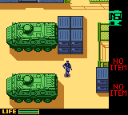
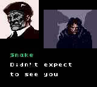
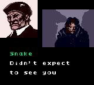

# Metal Gear Solid: Ghost Babel Color Corrections

This project provides color corrections for *Metal Gear Solid* on Game Boy Color, also known as *Metal Gear: Ghost Babel*.
Version 1.2.1 provides the Stage 2 APC correction and an optional patch set that also corrects Campbell's opening portrait.
The repository contains no game ROM.

## Corrections

### Stage 2 APCs

The APC patch corrects the two armored personnel carriers in Stage 2's yard outside Galuade fortress.
It corrects their front corners and lower left corners.
The original tiles use container and grass palettes, which produce gray, blue, navy, lime, and olive patches on the hulls.
The patch uses the hull's green colors and preserves the surrounding sand.
Six brown shadow pixels become dark green so all corrected tiles fit the room's available palettes.
It also corrects the APCs' thermal palette mapping.

### Campbell's opening portrait

The Campbell patch gives his face consistent skin colors and adjusts the collar and background boundaries.
Small outline and shading changes keep the portrait within each background tile's four-color limit.
The patch updates both portrait orientations and preserves Snake's colors, dialogue, and separate portrait fades.

The original artist's intent remains uncertain.
This correction offers an optional color interpretation.
[Campbell's documentation](campbell/README.md) describes its design, patch files, and test results.

## Download

The [version 1.2.1 release](https://github.com/afahy/ghost-babel-color-fix/releases/tag/v1.2.1) includes two patch sets.
Each set provides USA, European, and Japanese patches in BPS and IPS formats.

| Patch set | Contents | Download |
| --- | --- | --- |
| Primary | APC correction only | [APC archive](https://github.com/afahy/ghost-babel-color-fix/releases/download/v1.2.1/ghost-babel-apc-color-fix-v1.2.1.zip) |
| Optional | APC and Campbell corrections | [APC + Campbell archive](https://github.com/afahy/ghost-babel-color-fix/releases/download/v1.2.1/ghost-babel-apc-campbell-color-fixes-v1.2.1.zip) |

The primary set provides a version without Campbell's portrait correction.
The optional set contains both corrections in each patch.
Each patch requires a clean ROM; you cannot apply standalone BPS files sequentially.

### Primary APC-only patches

| Region | BPS | IPS |
| --- | --- | --- |
| USA | [USA BPS](patches/ghost-babel-apc-color-fix-us-v1.2.1.bps) | [USA IPS](patches/ghost-babel-apc-color-fix-us-v1.2.1.ips) |
| Europe | [European BPS](patches/ghost-babel-apc-color-fix-eu-v1.2.1.bps) | [European IPS](patches/ghost-babel-apc-color-fix-eu-v1.2.1.ips) |
| Japan | [Japanese BPS](patches/ghost-babel-apc-color-fix-jp-v1.2.1.bps) | [Japanese IPS](patches/ghost-babel-apc-color-fix-jp-v1.2.1.ips) |

### Optional APC + Campbell patches

| Region | BPS | IPS |
| --- | --- | --- |
| USA | [USA BPS](combined/patches/ghost-babel-color-corrections-us-v1.2.1.bps) | [USA IPS](combined/patches/ghost-babel-color-corrections-us-v1.2.1.ips) |
| Europe | [European BPS](combined/patches/ghost-babel-color-corrections-eu-v1.2.1.bps) | [European IPS](combined/patches/ghost-babel-color-corrections-eu-v1.2.1.ips) |
| Japan | [Japanese BPS](combined/patches/ghost-babel-color-corrections-jp-v1.2.1.bps) | [Japanese IPS](combined/patches/ghost-babel-color-corrections-jp-v1.2.1.ips) |

[Combined patch documentation](combined/README.md) provides target hashes and application details.
Version 1.2.1 rebuilds the IPS patches so that each record contains a complete edit.
Its BPS patches and patched ROMs match version 1.2.0.
The earlier [version 1.1 release](https://github.com/afahy/ghost-babel-color-fix/releases/tag/v1.1.0) contains the same APC correction only.

## Comparison

The images below show the difference between the original and patched ROMs.

### Video

https://github.com/user-attachments/assets/a74f9fd3-fadf-4979-bc6d-41d498496253

[Watch or download the comparison video](https://github.com/afahy/ghost-babel-color-fix/releases/download/v1.2.0/ghost-babel-before-after.mp4) (MP4, 42 seconds).
SameBoy recorded the original and combined USA ROMs side by side, with game audio.
The video includes Campbell, his mirrored portrait, and the normal and thermal APC views.

### APCs

| Original | Patched |
| --- | --- |
|  |  |

### Campbell

| Original | Patched |
| --- | --- |
|  |  |

SameBoy rendered these images directly from the original and patched ROMs.

## Required source ROMs

Use a clean ROM dump without an added copier header.
Select the primary or optional patch set and your dump's region.

| Region | Source ROM | Size | CRC32 | MD5 |
| --- | --- | --- | --- | --- |
| USA | Metal Gear Solid (USA) | 2,097,152 bytes | `04b0c5d6` | `f6dd1b1e5747412b9e5f25376c972d5a` |
| Europe | Metal Gear Solid (Europe) (En,Fr,De,Es,It) | 4,194,304 bytes | `16796957` | `7971c95ad9745fe20df52e03cd52f636` |
| Japan | Metal Gear - Ghost Babel (Japan) | 2,097,152 bytes | `7831f84d` | `7830328f323bd77d52a6985b1b10031f` |

The USA, European, and Japanese patch filenames contain `us`, `eu`, and `jp`, respectively.
The manifests contain additional source and target hashes.

The BPS patch checks the source ROM checksum.
The IPS format does not include a source checksum.

## Apply the patch

### Desktop with Floating IPS

[Floating IPS (Flips)](https://github.com/Sir-Walrus/Flips/releases) supports both BPS and IPS patches.

1. Obtain your own clean ROM dump.
2. Download Floating IPS for your operating system.
3. Start Floating IPS.
4. Select **Apply Patch**.
5. Select the BPS patch for your chosen patch set and ROM region.
6. Select your clean ROM dump.
7. Save the patched ROM as a separate file.
8. Start the patched ROM in your emulator or flash cartridge.

### Browser with Rom Patcher JS

1. Open [Rom Patcher JS](https://www.marcrobledo.com/RomPatcher.js/).
2. Select your clean dump in **ROM file**.
3. Select the matching patch set and regional BPS patch in **Patch file**.
4. Select **Apply patch**.
5. Save the patched ROM as a separate file.

Use a fresh emulator session to load the changed graphics and palettes.

## Apply with Python

The included tool requires Python 3.8 or later and uses only the standard library.
The tool checks all source hashes and verifies the patched ROM hashes.
It detects the USA, European, or Japanese source automatically.
It rejects an existing output file.

The apply command selects the primary APC-only set when you omit `--fix`.
Use `--fix combined` to select the optional APC + Campbell set.

Run the command for your desired patch set from the repository directory:

```sh
python patch.py apply "/path/to/Metal Gear Solid (USA).gbc" "/path/to/Metal Gear Solid (USA) (APC Color Fix).gbc"
python patch.py --fix combined apply "/path/to/Metal Gear Solid (USA).gbc" "/path/to/Metal Gear Solid (USA) (APC and Campbell).gbc"
```

Each command produces a separate ROM containing its selected patch set.
The `verify` command checks the clean source without writing a ROM:

```sh
python patch.py --fix combined verify "/path/to/Metal Gear Solid (USA).gbc"
```

## Rebuild the patch files

Build both release patch sets for a clean regional source ROM:

```sh
python patch.py build "/path/to/Metal Gear Solid (USA).gbc"
```

Build only one selected patch set:

```sh
python patch.py --fix apc build "/path/to/Metal Gear Solid (USA).gbc"
python patch.py --fix combined build "/path/to/Metal Gear Solid (USA).gbc"
```

The default build recreates both sets of regional BPS and IPS files.
An explicit `--fix` option limits the build to that selection.

| Patch set | Manifests | Build output |
| --- | --- | --- |
| APCs | `changes.json`, `changes-eu.json`, `changes-jp.json` | `patches/` |
| APC + Campbell | `combined/changes-us.json`, `combined/changes-eu.json`, `combined/changes-jp.json` | `combined/patches/` |

Each manifest records the source and target hashes.
The APC and Campbell manifests record the edits and expected original bytes; the combined manifests reuse those edits.
The build does not require the disassembly project, an assembler, or game assets from another repository.
The [Campbell documentation](campbell/README.md) also describes the retained Campbell-only build option.

## Scope and compatibility

Both corrections change graphics and palette data and update the ROM's global checksum.
They add no executable code, sprite overlays, or scanline palette changes.

| Correction | Technical notes | Validation |
| --- | --- | --- |
| APCs | [ROM edits and palette mapping](TECHNICAL.md) | [Room comparisons and emulator checks](VALIDATION.md) |
| Campbell | [Portrait tiles and palettes](campbell/TECHNICAL.md) | [Intro and gameplay checks](campbell/VALIDATION.md) |
| Combined builds | Both corrections with one checksum update | [Combined emulator checks](campbell/COMBINED_VALIDATION.md) |

The APC checks cover normal and thermal rendering and movement in all three regions.
The Campbell checks cover the USA introduction and gameplay in PyBoy and SameBoy.
European and Japanese Campbell checks cover the opening scene in PyBoy.
Combined ROMs passed these checks as well.

Each standalone patch requires its matching clean regional release.
Other patch combinations remain untested.
Physical Game Boy Color hardware remains untested.

## Python development

[CONTRIBUTING.md](CONTRIBUTING.md) explains the Ruff code checks and formatter.
GitHub Actions checks Python code and formatting for each push and pull request.
It also runs the ROM-free tests on Python 3.8 and 3.13.

## Credits and license

Color corrections: Adam Fahy.
Original game: Konami.

The [MIT license](LICENSE) covers the patch tools and original documentation.
The license grants no rights to the original game or its graphics.
